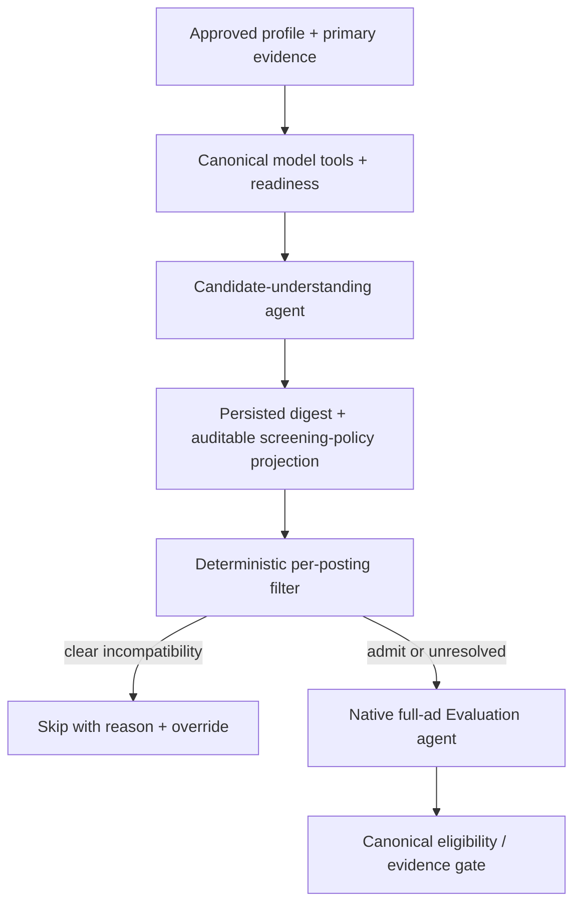

# Assessment failures, first filtering and candidate understanding

## 2026-10-28 execution update: provider acceptance remains blocked

The revised digest/native slice was exercised once on posting 7621, using the
approved native runtime identity and DeepSeek route. It failed with unknown_evidence:
29 total paid operations, 371,872 known actual tokens, 376,015 charged tokens,
198.84 seconds, no canonical evaluation. One classifier operation had unknown
usage. The cold candidate digest completed in 12 model calls / 147,776 measured
tokens; job assessment used 15 model calls, one embedding operation and the
existing unknown-usage public classifier operation. Neither efficiency nor assessment
acceptance passed. Automatic assessment remains paused; no deployment is justified.

Read-only journal analysis found 63 primary evidence records. After one explicit
read of 45 records, eight subsequent calls requested only records already read.
The last read contained six unknown IDs. This is not a demonstrated evidence
coverage or canonical quality success, even though candidate digestion completed.

A separate concrete protocol defect was found: ten of the fifteen evaluation
responses contained reasoning_content, but NativeModel discarded it and LangChain's
OpenAI conversion also omitted it from additional_kwargs. DeepSeek's
[official thinking/tool-call protocol](https://api-docs.deepseek.com/guides/thinking_mode)
requires reasoning_content to be passed back with subsequent tool requests.
The adapter now retains it in private messages/checkpoints and restores it on the
wire. A synthetic native-graph test failed for the missing field before the fix
and passed afterward, including zero-call completed reuse. No private reasoning
text is reproduced here. Whether the loss caused the repetitive reads, and whether
the correction improves real behavior, remain unverified; no second paid run was made.

Review also identified and repaired two deterministic/accounting defects: operating
hours in a later clause inheriting the applicant's earlier subject, and historical
digest charges being subtracted from a fresh budget after expiry. The latter now
uses reservation identity rather than historical run totals. Focused synthetic
checks cover both sentence orders and old/resumed/fresh budget accounting.

The checkout is an implementation candidate, not an accepted live release.
Full release-suite and deployment claims require their own recorded evidence.

Original read-only investigation: 2026-10-27, TASK-279. That investigation made no new paid inference. This supplements
[the codebase map](codebase-map.md), rather than claiming a repaired deployment.

## Owner's clarified sequence

> basically before the filtering start the LLM should PROPERLY ACCESSED AND APPLY ALL OF THE MODELS and DIGEST the Candidate's Profile

The candidate-understanding stage belongs before personal job filtering. It must
read approved profile and primary evidence, invoke applicable canonical model
tools, interpret their outputs and readiness, then persist an evidence-bound
digest. Reuse that digest across postings until relevant inputs change. This is
not repeated cold candidate reasoning for every job.

The approved profile owns personal facts and preferences. Mathematical code owns
calculations. The digest explains and connects them; it cannot invent years,
qualifications, availability, work rights, model readiness or consent. A policy
projection must cite approved inputs and distinguish existing policy from a new
recommendation needing confirmation. No model text silently broadens exclusion.

"All models" means every applicable model is accessed and its status represented:
structural occupational analysis; learned preference model/readiness; historical
callback posterior; response-time readiness; relevant retrieval and scoped Jev
capabilities. Do not fabricate predictions from unavailable or untrained models,
automatically refit statistical models, or send candidate data down an unapproved
Jev route. Job-specific model predictions need the posting's inputs and therefore
are calculated when those inputs exist, using the reusable candidate digest.

Cache identity needs person, approved profile version, primary evidence hashes,
policy, reference/mapping versions, model-fit and relevant history snapshots,
digest prompt/skill/schema and provider model. Changed source data makes the
affected digest stale; a completed paid response should not be repeated merely
because later persistence failed. Digest cost is reported separately from each
job's screening/evaluation cost, including cold and amortized measurements.

**Current gap:** deployed code has a cached candidate assessment, but does not
establish this complete model-aware prefilter digest. Pending native code removes
paid candidate assessment rather than implementing the clarified reusable stage.
It therefore needs design adjustment before acceptance; no new digest is claimed
implemented or deployed by this document.

## Existing-run evidence

Sources: saved count-only acceptance logs, private autonomous response journal,
and a local replay of validators. Only structural/numeric results are recorded
here; no candidate source text is copied into Git.

| Run | Paid operations in invocation | Known actual tokens | Charged tokens | Seconds | Result |
|---|---:|---:|---:|---:|---|
| DeepSeek 7621 attempt 1 | 3 | 18,527 | 22,670 | 67.92 | invalid_model_payload |
| Attempt 2 | 10 | 74,450 | 78,593 | 114.66 | assessment_call_limit |
| Attempt 3 | 8 | 64,723 | 68,866 | 83.95 | assessment_call_limit |
| Attempt 4 | 3 | 19,087 | 23,230 | 61.52 | invalid_citation |

These totals include classifier and embedding operations, not just chat turns.
Each invocation had one unknown-usage operation; known actual tokens are not the
entire invocation's measured usage. Four attempts total 176,787 known actual and
193,359 charged tokens, with no valid canonical evaluation. They used changing
source/skill bindings, so they are separate experiments, not evidence that an
unchanged checkpoint repeatedly dispatched completed work.

## Confirmed failure mechanisms

| Finding | Observed evidence | Architectural implication |
|---|---|---|
| Late incompatible validation in live 2143 | Saved JobSummary validates, but report B has 4,971 characters; AgenticEvaluation._report rejects any section above 4,000. The saved 18 requirements have 18 unique matches. | A terminal tool accepts output that canonical assembly later rejects. Surface the canonical constraint at completion, with local field-specific feedback rather than losing the paid assessment. |
| Missing schema fields in DeepSeek | Attempts 1, 3 and 4 initially called complete_requirements with only requirements, missing facts, location_fit and legitimacy. | The native tool combines requirement extraction with substantial additional fields; one description/prompt change did not ensure compliance. Keep tool contracts focused and provide bounded targeted correction without changing facts. |
| Decorative browsing overhead | Attempt 2 has six native responses, including two ls calls. | Generic filesystem tools distracted a narrow stage; pending source prunes them. |
| Efficiency target used as hard limit | Attempts 2 and 3 stopped at six native responses. Attempt 3 had reached evidence retrieval and two primary-evidence reads. | The target was incorrectly converted into an execution cap. It prevented completion; removing it does not prove efficiency. Pending source now honors configured limits instead. |
| Unsupported ad quote | Attempt 4's complete extraction has 12 requirements; requirement/location citations pass. Work-rights requirement is none_stated, but its supplied 29-character quote is absent from the ad and normalization also fails. | Citation rejection is valid, not a whitespace false positive. The whole-stage abort is avoidably rigid; return targeted feedback and require a valid correction, preserving the safety check. |
| Context grows despite native tools | Attempt 3's six native prompts grow from 4,880 to 14,010 tokens; cumulative native prompt tokens 57,652, completion 6,621. | Native transport alone does not control context. Retrieval payloads and repeated extraction/schema output still cost tokens. Cache-token metadata exists, so processed token totals are not a dollar-cost estimate. |

For live 2143 the wrapper journal records 22 calls, 223,866 tokens and 305.77
seconds. Broader incident accounting previously recorded 25 calls and 225,422
tokens. These are different scopes and must not be substituted for each other.
The matching role recorded two batch searches, eight evidence reads and one
targeted search; the summary role then read evidence three more times and used
two research tools. The wrapper preserved the serial work rather than replacing it.

Replay commands were executed locally against stored responses without provider
calls. The same saved summary passes JobSummary and fails the canonical report
validator. Ad-extraction replay identifies the rights quote as the failing field.
These prove specific boundaries; they do not establish assessment quality or a
successful repaired end-to-end run.

## Old Jobwatch and Career Ops comparison

| Boundary | Archived Jobwatch 68235dd | Deployed/pending Jobwatch | Career Ops |
|---|---|---|---|
| Cheap first filter | Rules.evaluate rejects unmatched titles, off-target/senior classifications, location and excess required years before model work; rights/full-time often flags | Profile-driven terms/rules and overrides replace shared personal assumptions; direct-path early ordering repair remains pending | scan.mjs performs zero-model collection/filtering and dedupe |
| Candidate context | Shared configured arms/thresholds and profile context; not proof of a complete learned digest | Deployed paid candidate assessment is cached but separate from complete prefilter model digestion; pending version removed paid assessment | Triage loads only compact user-layer _brief.md rather than full CV/evaluation context |
| Ambiguous first-pass judgment | Not equivalent to full evidence evaluation | Optional cheap judgment must be justified; deterministic clear cases should stop first | triage gives compact PASS/MARGINAL/FAIL/SKIP; upstream interactive mode leaves promotion to the user |
| Full evaluation | Retained reader/pipeline behavior is separate from native canonical contracts | Live multi-role loops plus wrapper; pending single native graph still fails acceptance | oferta A–H are report sections, not a required model invocation for every section |
| Factual safety | Different guarantees; cheap filtering success does not establish canonical evaluation quality | Exact citations, policy and gate remain mandatory; terminal schemas must agree | Reports request primary evidence; separate CV fact gate checks allowed facts |

The archived filter's advantage is cheap early exits, not evidence that its
personal thresholds should be restored unchanged. The current years table is
entry=4, junior=5, mid=8, selected from approved level; it is **not calculated from
the candidate's actual experience duration**. This corrects the earlier phrase
"profile-derived experience caps." Seniority title checks are deterministic.

Region/remote keyword matching and rights/hours rules already exist. Commute
measurement is deterministic but currently has Victoria-only place data. Clear
incompatibility can skip without an LLM; missing facts, negation, mixed options,
remote restrictions and temporary/program exceptions must remain explicit.

The owner's clarified design adds a proper reusable candidate/model digest before
these cheap gates, while retaining canonical fact ownership and explainable rules.
It does not justify doing full candidate analysis once for each admitted posting.

Sources: archived `/home/phroggingphrog/apps/jobwatch/jobwatch/filters.py`
is a local comparison snapshot at 68235dd, not the deployed runtime;
[current filter](../../jobwatch/filters.py), [prescreen sync](../../jobwatch/prescreen/sync.py),
[native completion](../../pipeline/agentic/autonomous.py),
[summary schema](../../pipeline/agentic/evaluator.py),
[canonical evaluation](../../pipeline/agentic/contracts.py).

Upstream sources checked 2026-10-27:
[scan.mjs](https://github.com/career-ops-hq/career-ops/blob/main/scan.mjs),
[triage mode](https://github.com/career-ops-hq/career-ops/blob/main/modes/triage.md),
[DeepWiki comparison](https://deepwiki.com/search/compare-scan-deterministic-key_f62969e8-2dd1-4d78-bfb0-b3366524b97d)
and [returned glossary reference](https://deepwiki.com/career-ops-hq/career-ops#12).
Upstream score weights, default thresholds and estimated compensation are not
automatically approved Jobwatch policy.
