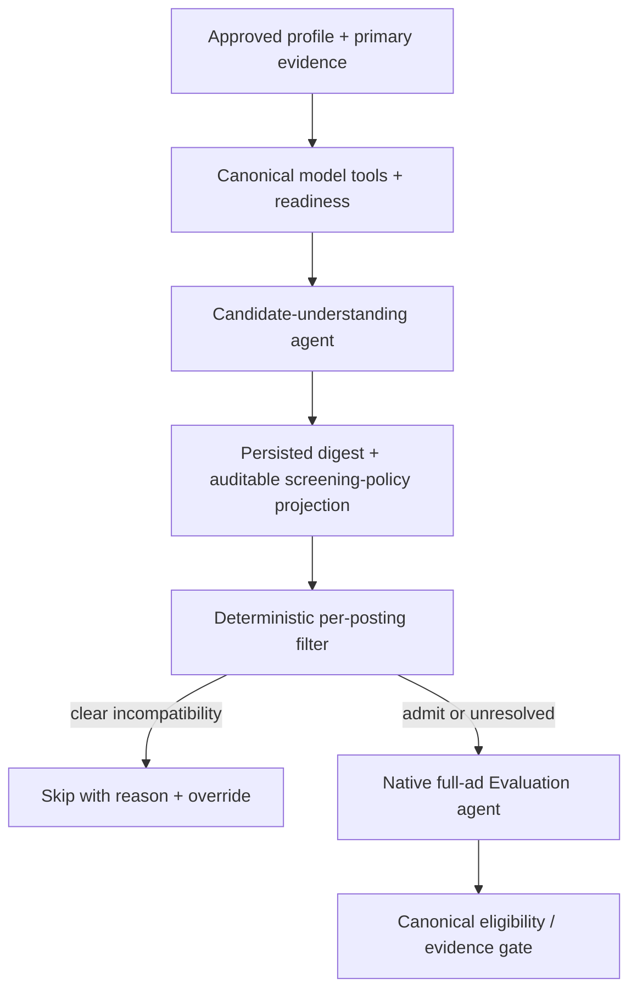

# Assessment failures, first filtering and candidate understanding

## Native career-ops comparison and first-filter repair

The owner explicitly requested installing career-ops with their profile and then
running its full native pipeline. The verified reference is
`career-ops-hq/career-ops` at `b5e4c26f21efee31559296495d794c9a9564a714`.
Its standalone `openai-eval.mjs` baseline generated a report in one model call
(55,368 reported tokens, 67.29 seconds). That script accepts nonempty free-form
output; report creation is not canonical assessment acceptance.

The separate native OpenCode comparison ended at the stock dealbreaker gate,
before A-G evaluation or document generation. A workspace inherited from the
native API environment initially bound the CLI session to the wrong checkout,
causing repeated external-directory denials. The parent stopped it, corrected
PWD/session location and allowed only the reference code/private data boundaries,
disabled parent config inheritance, then resumed the existing session. Successful
native reads confirmed the repair. Initial failures and paid history are retained.

Across initial and resumed execution the gateway recorded 69 requests: 67 HTTP
200 and two cancelled, 2,965,124 input tokens and 20,254 output tokens, with
2,890,752 cached input tokens reported. These include setup overhead and are not
an evaluated-job efficiency benchmark. Usage for cancellation may be unknown.
The resumed run took 260.03 seconds; overall elapsed time was 599.67 seconds.
The model-written receipt's one-paid-operation claim and stage totals are wrong:
the gateway/session totals reconcile, while enumerated stages are four completed,
seven skipped and two blocked. Model receipts are not accounting authorities.
The stock workflow needs explicit `evaluate anyway` to bypass the person's real
location rule; no override was manufactured and no PDF/application was produced.

A zero-model, read-only examination of the same location boundary exposed an
independent prescreen defect: an allowed country breadcrumb masked a disallowed
specific state in the same field. A synthetic regression reproduced it. Generated
rules now describe parent-country fallback terms by region tag; the generic
engine ignores that fallback when a specific state is present. Country-only,
explicit nationwide, allowed-state alternatives and remote exceptions remain
admitted. Engine and projection versions invalidate stale screening bindings.
Focused checks passed 158 tests. The original read-only posting check now returns
`skip/location_outside` with zero model calls and zero Jobwatch data writes.
This repair is development source only, not a native deployment.

## Canonical completion contract repair at 81fd5d2

The subsequent custom-combo run at `4a6e4fb` failed `invalid_model_payload`:
10 native generations plus one public classifier, one embedding, zero digest
calls, 168,875 known actual tokens, 173,018 charged tokens and 241.16 seconds.
Accounting reconciled; no canonical evaluation or completed reuse was established.
All function arguments were valid JSON in this run.

Private offline inspection found a producer-contract defect. Canonical completion
requires five exact dimension names, while the tool schema advertised an arbitrary
dictionary. Validation then incorrectly identified `matches` as the failing field.
Both completion attempts failed the dimension check. The first otherwise retained
valid coverage, source/hash/quote citations and retrieved evidence; it also lacked
risk/mitigation for one essential gap. The wrongly directed rewrite introduced
additional citation errors. This is evidence of misleading validation feedback,
not a reason to weaken canonical checks.

The repair advertises exact dimension/report keys and section limits, identifies
only safe declared validation fields, and returns both missing gap fields. Read
results report remaining primary IDs from reconstructed tool history; progress
does not grant citation access. Final focused verification passed 64 tests in
108.11 seconds; the independent bounded review passed all three new contract
checks without blockers. The rebuilt wheel matches current agent, validation,
incident and protocol source bytes. These are offline results; provider acceptance
and deployment require their separate measured checks.

## Controlled contract revalidation: provider still noncompliant

Run `task279-native-combo-acceptance-895dde66fb804bb2941ba46be632cdd0`
used `81fd5d2` and the dedicated OmniRoute combo. The ad was active, the digest
current, and only the recorded previous `invalid_model_payload` incident was
released. Two native requirements calls plus one classifier cost 18,119 known
actual tokens / 22,262 charged tokens in 69.48 seconds. There were no digest calls
or embeddings. The batch ledger reconciled exactly.

Both calls supplied only the `requirements` top-level field. The gateway's saved
request advertised required `requirements`, `facts`, `location_fit`, `legitimacy`;
the second request also contained the canonical missing-fields ToolMessage.
The route nevertheless repeated the incomplete call and exhausted the bounded
correction. The result is held `missing_required_fields`, with retained incident
`bfeefce9b5688b93b3af5ab71940a2f0`. This establishes noncompliance on the observed
route, without attributing it conclusively to DeepSeek or OpenCode mediation.
No canonical evaluation, gate or real completed reuse exists; three calls before
failure do not pass efficiency acceptance.

No additional paid attempt was queued. The full normal-context release suite was
started prematurely and stopped after provider acceptance failed; it is not a
full-suite pass. Focused checks, code check and rebuilt wheel evidence remain
valid only for their stated scope. Live source remains `9111a0d`, execution mode
is off, the reader timer is paused and collect-only timers remain active. Deployed
Engine-generated rules were resynchronized without changing person-owned rules.
Native API and web health checks pass. No merge, deployment or automatic assessment
activation was performed. Count-only evidence is retained under the existing
Jobwatch backups directory; all journals and charged usage remain intact.

## Native format recovery and scoped protocol combo

The owner requested continued troubleshooting and authorized a custom combo with
prompt injection. Offline reproduction confirmed that malformed arguments died
in NativeModel before tool feedback. Evaluation now preserves the original raw
arguments/reasoning and returns one syntax-error ToolMessage for a known tool,
without executing a parsed prefix or silently stripping the extra brace.
Unknown tools, missing IDs and non-object arguments still fail closed. Cached
feedback is returned before dispatch, with the feedback and correction count
saved atomically, so restored state cannot turn an old rejection into a new action.

Focused integration passed 107 tests. Final incident/recovery checks passed 54,
including pause on exhausted syntax correction. The offline-built wheel contains
the exact packaged protocol prompt; the final wheel must be rebuilt for release
after any subsequent source changes. Bounded review findings on replay and missing
package data were resolved. These checks do not establish provider acceptance.

OmniRoute trace metadata matched the failing 7,605-byte argument hash in both
Jobwatch and the stored provider-side response. The executed route was
`opencode-go/deepseek-v4.1-flash`; no independent wire capture distinguishes
DeepSeek generation, OpenCode mediation or earlier gateway preprocessing.
The original `deepseek-flash` combo currently contains two leaves and was not edited.

The dedicated `jobwatch-assessment-deepseek` combo uses the observed pinned
OpenCode Go DeepSeek connection only, without fallback and with combo retries
disabled. Its gateway `system_message` stays empty: that gateway field replaces
existing system instructions. Jobwatch instead appends the generic packaged
protocol prompt to the complete Evaluation system context, once per request.
Per-person `assessment_combo` and `assessment_prompt_hash` profile fields bind
the actual route and exact prompt revision to service/checkpoint reuse. A hash
mismatch refuses dispatch. Candidate understanding and other model roles keep
their existing selections; read-only verification found the current owner digest
still reusable after the new binding. No provider success or deployment is implied.

## Provider acceptance at 998f116: malformed native arguments

The single prepared `native-assessment-acceptance` run on posting 7621 used source
`998f116b68228cdfb9cb78acd18c9dba7ae68901`. The ad was active and the current digest
was reused with zero digest calls. Only the explicitly recorded prior skill-path
incident was released; no unrelated incident was changed.

The run failed `invalid_native_response`: two native model calls and one public
classifier, zero embeddings, 17,068 known actual tokens, 21,211 charged tokens,
one unknown-usage operation and 52.89 seconds. The persisted batch charge equals
the measured invocation charge. There is no canonical evaluation, gate result or
real completed-reuse proof. Three calls fall within the numerical target range
only because assessment stopped early; this is not a successful efficiency result.

Saved response metadata establishes the boundary without publishing candidate
content or reasoning. The first `complete_requirements` arguments were valid JSON
but contained only `requirements`; one persisted `missing_required_fields`
correction was returned. The second supplied all six extraction fields, but its
7,605-byte argument string had one trailing closing brace after the complete JSON
object. Strict decoding reported `Extra data` at character 7,604. The response
journal preserved it before parsing; no truncation, missing credential or HTTP
failure was established. No argument repair or another paid attempt was made.

Quality acceptance is false despite the numeric range flag. OpenSpec remains
8/14 complete, with tasks 4.1 onward open. Full release testing, main reconciliation,
deployment and automatic activation are deferred by the approved failure gate.
The owner digest remains current; the new invalid-response incident, all charged
usage and checkpoints remain retained. The deployed Engine resynchronized generated
profile rules for the still-running old runtime, preserving person-owned rules.
Automatic reader scheduling remains paused and deterministic collectors remain active.
The existing legacy notification channel attempted its normal failure alert but
delivery failed; no notification test or resend was performed.

## Acceptance follow-up readiness

The `native-assessment-acceptance` follow-up reproduces the recorded multi-search,
repeated-read and candidate-filename sequence through the real graph with synthetic
evidence. It reaches canonical completion without opening the filename, restores
reasoning/source payloads on interruption, and preserves exhausted correction
allowances across restart. The focused native/recovery group passed 43 tests.
These scripted responses are correctness fixtures, not evidence of provider
quality or a successful eight-call efficiency result.

Count-only acceptance diagnostics in `eval_metrics.native_acceptance_report`
separate canonical quality, efficiency, current-digest reuse, ledger reconciliation
and zero-paid completed reuse. They require at least one fresh native generation;
a cached result plus classifier/embedding charges cannot masquerade as provider
acceptance. Every per-job generation, including public classifiers, contributes
to the 3–6-call target. Embeddings remain visible separately and in all paid
operations. Thus the previous warm run had seven model calls and eight paid
operations; it failed quality and did not establish the efficiency target.

The authenticated discovery API now has an invocation-only `max_assessments`
control for the eventual one-posting runtime check. Its scope, deferral and cost
limits are documented in [the backend contract](../../pipeline/agentic/CHAT.md).
This is development source; provider acceptance and deployment remain open until
the measured execution below establishes otherwise.

## Recovery follow-up: warm-digest acceptance still blocked

One further controlled evaluate-only run on posting 7621 reused the current digest
with zero candidate-understanding calls. It used six native model calls, one
embedding operation and one unknown-usage public classifier operation: eight paid
operations, 63,184 known actual tokens, 67,327 charged tokens and 75.01 seconds.
The persisted batch charge equals the invocation charge. It failed
`skill_path_not_allowed`; no canonical evaluation or completed-reuse acceptance
was produced. The six native calls do not establish the efficiency target for a
successful assessment. The previous cold run's total includes separate digest
work and is not a like-for-like per-job token comparison.

The saved tool-name trace is: complete requirements, batch evidence search,
read 22 evidence IDs, read two IDs, refined evidence search, then
`read_file("master_resume.md")`. No candidate file was opened through the skill
tool. The tool's generic description failed to explain that it exposes packaged
skills only, and the denied path aborted rather than returning useful guidance.
The description and bounded correction now direct candidate reads to canonical
evidence IDs. This last repair is offline-only; no subsequent paid run was made.

The same follow-up removes the redundant supplied-ad tool, suppresses repeated
primary payloads while retaining exact source access, and gives unknown evidence
IDs one targeted correction. Review caught an intermediate checkpoint-loss defect:
canonical action access could suppress the only restored source payload. Emitted
evidence is now reconstructed from actual checkpoint tool messages independently
of access history. Synthetic tests verify exact source and reasoning transcript
restoration, journal reuse and zero-call completed reuse. Evaluation source hashes
invalidate job results separately from the unchanged reusable digest.

Automatic assessment remains paused, the live revision remains `9111a0d`, and
collect-only timers remain active. The development acceptance's generated profile
rules were resynchronized through the deployed Engine; person-owned rules and
overrides, incidents, usage and checkpoints were preserved. No deployment or
further paid experiment is justified by these checks alone.

## 2026-10-28 execution update: provider acceptance remains blocked

The revised digest/native slice was exercised once on posting 7621, using the
approved native runtime identity and DeepSeek route. It failed with unknown_evidence:
29 total paid operations, 371,872 known actual tokens, 376,015 charged tokens,
198.84 seconds, no canonical evaluation. One classifier operation had unknown
usage. The cold candidate digest completed in 12 model calls / 147,776 measured
tokens; job assessment used 15 model calls, one embedding operation and the
existing unknown-usage public classifier operation. Neither efficiency nor assessment
acceptance passed. Automatic assessment remains paused; no deployment is justified.

Read-only journal analysis found 63 primary evidence records. After one explicit
read of 45 records, eight subsequent calls requested only records already read.
The last read contained six unknown IDs. This is not a demonstrated evidence
coverage or canonical quality success, even though candidate digestion completed.

A separate concrete protocol defect was found: ten of the fifteen evaluation
responses contained reasoning_content, but NativeModel discarded it and LangChain's
OpenAI conversion also omitted it from additional_kwargs. DeepSeek's
[official thinking/tool-call protocol](https://api-docs.deepseek.com/guides/thinking_mode)
requires reasoning_content to be passed back with subsequent tool requests.
The adapter now retains it in private messages/checkpoints and restores it on the
wire. A synthetic native-graph test failed for the missing field before the fix
and passed afterward, including zero-call completed reuse. No private reasoning
text is reproduced here. Whether the loss caused the repetitive reads, and whether
the correction improves real behavior, remain unverified; no second paid run was made.

Review also identified and repaired two deterministic/accounting defects: operating
hours in a later clause inheriting the applicant's earlier subject, and historical
digest charges being subtracted from a fresh budget after expiry. The latter now
uses reservation identity rather than historical run totals. Focused synthetic
checks cover both sentence orders and old/resumed/fresh budget accounting.

The checkout is an implementation candidate, not an accepted live release.
The full file-sharded source run at `178b4c8` collected 4,370 cases: 4,352 passed,
2 skipped, one stale ingest assertion and 15 application fixture-setup errors.
Only the old ingest test expectation was changed to assert the canonical archive
and audit record. A fixture-first targeted follow-up passed 17 tests, including
the affected cases. Production code was unchanged after the full run; its source
manifest reported no changes during testing. The original suite was not clean
and is recorded separately from the follow-up. Native-environment `check --code`
and bounded review passed. Deployment and valid provider acceptance remain blocked.

Original read-only investigation: 2026-10-27, TASK-279. That investigation made no new paid inference. This supplements
[the codebase map](codebase-map.md), rather than claiming a repaired deployment.

## Owner's clarified sequence

> basically before the filtering start the LLM should PROPERLY ACCESSED AND APPLY ALL OF THE MODELS and DIGEST the Candidate's Profile

The candidate-understanding stage belongs before personal job filtering. It must
read approved profile and primary evidence, invoke applicable canonical model
tools, interpret their outputs and readiness, then persist an evidence-bound
digest. Reuse that digest across postings until relevant inputs change. This is
not repeated cold candidate reasoning for every job.

The approved profile owns personal facts and preferences. Mathematical code owns
calculations. The digest explains and connects them; it cannot invent years,
qualifications, availability, work rights, model readiness or consent. A policy
projection must cite approved inputs and distinguish existing policy from a new
recommendation needing confirmation. No model text silently broadens exclusion.

"All models" means every applicable model is accessed and its status represented:
structural occupational analysis; learned preference model/readiness; historical
callback posterior; response-time readiness; relevant retrieval and scoped Jev
capabilities. Do not fabricate predictions from unavailable or untrained models,
automatically refit statistical models, or send candidate data down an unapproved
Jev route. Job-specific model predictions need the posting's inputs and therefore
are calculated when those inputs exist, using the reusable candidate digest.

Cache identity needs person, approved profile version, primary evidence hashes,
policy, reference/mapping versions, model-fit and relevant history snapshots,
digest prompt/skill/schema and provider model. Changed source data makes the
affected digest stale; a completed paid response should not be repeated merely
because later persistence failed. Digest cost is reported separately from each
job's screening/evaluation cost, including cold and amortized measurements.

**Current gap:** deployed code has a cached candidate assessment, but does not
establish this complete model-aware prefilter digest. Pending native code removes
paid candidate assessment rather than implementing the clarified reusable stage.
It therefore needs design adjustment before acceptance; no new digest is claimed
implemented or deployed by this document.

## Existing-run evidence

Sources: saved count-only acceptance logs, private autonomous response journal,
and a local replay of validators. Only structural/numeric results are recorded
here; no candidate source text is copied into Git.

| Run | Paid operations in invocation | Known actual tokens | Charged tokens | Seconds | Result |
|---|---:|---:|---:|---:|---|
| DeepSeek 7621 attempt 1 | 3 | 18,527 | 22,670 | 67.92 | invalid_model_payload |
| Attempt 2 | 10 | 74,450 | 78,593 | 114.66 | assessment_call_limit |
| Attempt 3 | 8 | 64,723 | 68,866 | 83.95 | assessment_call_limit |
| Attempt 4 | 3 | 19,087 | 23,230 | 61.52 | invalid_citation |

These totals include classifier and embedding operations, not just chat turns.
Each invocation had one unknown-usage operation; known actual tokens are not the
entire invocation's measured usage. Four attempts total 176,787 known actual and
193,359 charged tokens, with no valid canonical evaluation. They used changing
source/skill bindings, so they are separate experiments, not evidence that an
unchanged checkpoint repeatedly dispatched completed work.

## Confirmed failure mechanisms

| Finding | Observed evidence | Architectural implication |
|---|---|---|
| Late incompatible validation in live 2143 | Saved JobSummary validates, but report B has 4,971 characters; AgenticEvaluation._report rejects any section above 4,000. The saved 18 requirements have 18 unique matches. | A terminal tool accepts output that canonical assembly later rejects. Surface the canonical constraint at completion, with local field-specific feedback rather than losing the paid assessment. |
| Missing schema fields in DeepSeek | Attempts 1, 3 and 4 initially called complete_requirements with only requirements, missing facts, location_fit and legitimacy. | The native tool combines requirement extraction with substantial additional fields; one description/prompt change did not ensure compliance. Keep tool contracts focused and provide bounded targeted correction without changing facts. |
| Decorative browsing overhead | Attempt 2 has six native responses, including two ls calls. | Generic filesystem tools distracted a narrow stage; pending source prunes them. |
| Efficiency target used as hard limit | Attempts 2 and 3 stopped at six native responses. Attempt 3 had reached evidence retrieval and two primary-evidence reads. | The target was incorrectly converted into an execution cap. It prevented completion; removing it does not prove efficiency. Pending source now honors configured limits instead. |
| Unsupported ad quote | Attempt 4's complete extraction has 12 requirements; requirement/location citations pass. Work-rights requirement is none_stated, but its supplied 29-character quote is absent from the ad and normalization also fails. | Citation rejection is valid, not a whitespace false positive. The whole-stage abort is avoidably rigid; return targeted feedback and require a valid correction, preserving the safety check. |
| Context grows despite native tools | Attempt 3's six native prompts grow from 4,880 to 14,010 tokens; cumulative native prompt tokens 57,652, completion 6,621. | Native transport alone does not control context. Retrieval payloads and repeated extraction/schema output still cost tokens. Cache-token metadata exists, so processed token totals are not a dollar-cost estimate. |

For live 2143 the wrapper journal records 22 calls, 223,866 tokens and 305.77
seconds. Broader incident accounting previously recorded 25 calls and 225,422
tokens. These are different scopes and must not be substituted for each other.
The matching role recorded two batch searches, eight evidence reads and one
targeted search; the summary role then read evidence three more times and used
two research tools. The wrapper preserved the serial work rather than replacing it.

Replay commands were executed locally against stored responses without provider
calls. The same saved summary passes JobSummary and fails the canonical report
validator. Ad-extraction replay identifies the rights quote as the failing field.
These prove specific boundaries; they do not establish assessment quality or a
successful repaired end-to-end run.

## Old Jobwatch and Career Ops comparison

| Boundary | Archived Jobwatch 68235dd | Deployed/pending Jobwatch | Career Ops |
|---|---|---|---|
| Cheap first filter | Rules.evaluate rejects unmatched titles, off-target/senior classifications, location and excess required years before model work; rights/full-time often flags | Profile-driven terms/rules and overrides replace shared personal assumptions; direct-path early ordering repair remains pending | scan.mjs performs zero-model collection/filtering and dedupe |
| Candidate context | Shared configured arms/thresholds and profile context; not proof of a complete learned digest | Deployed paid candidate assessment is cached but separate from complete prefilter model digestion; pending version removed paid assessment | Triage loads only compact user-layer _brief.md rather than full CV/evaluation context |
| Ambiguous first-pass judgment | Not equivalent to full evidence evaluation | Optional cheap judgment must be justified; deterministic clear cases should stop first | triage gives compact PASS/MARGINAL/FAIL/SKIP; upstream interactive mode leaves promotion to the user |
| Full evaluation | Retained reader/pipeline behavior is separate from native canonical contracts | Live multi-role loops plus wrapper; pending single native graph still fails acceptance | oferta A–H are report sections, not a required model invocation for every section |
| Factual safety | Different guarantees; cheap filtering success does not establish canonical evaluation quality | Exact citations, policy and gate remain mandatory; terminal schemas must agree | Reports request primary evidence; separate CV fact gate checks allowed facts |

The archived filter's advantage is cheap early exits, not evidence that its
personal thresholds should be restored unchanged. The current years table is
entry=4, junior=5, mid=8, selected from approved level; it is **not calculated from
the candidate's actual experience duration**. This corrects the earlier phrase
"profile-derived experience caps." Seniority title checks are deterministic.

Region/remote keyword matching and rights/hours rules already exist. Commute
measurement is deterministic but currently has Victoria-only place data. Clear
incompatibility can skip without an LLM; missing facts, negation, mixed options,
remote restrictions and temporary/program exceptions must remain explicit.

The owner's clarified design adds a proper reusable candidate/model digest before
these cheap gates, while retaining canonical fact ownership and explainable rules.
It does not justify doing full candidate analysis once for each admitted posting.

Sources: archived `/home/phroggingphrog/apps/jobwatch/jobwatch/filters.py`
is a local comparison snapshot at 68235dd, not the deployed runtime;
[current filter](../../jobwatch/filters.py), [prescreen sync](../../jobwatch/prescreen/sync.py),
[native completion](../../pipeline/agentic/autonomous.py),
[summary schema](../../pipeline/agentic/evaluator.py),
[canonical evaluation](../../pipeline/agentic/contracts.py).

Upstream sources checked 2026-10-27:
[scan.mjs](https://github.com/career-ops-hq/career-ops/blob/main/scan.mjs),
[triage mode](https://github.com/career-ops-hq/career-ops/blob/main/modes/triage.md),
[DeepWiki comparison](https://deepwiki.com/search/compare-scan-deterministic-key_f62969e8-2dd1-4d78-bfb0-b3366524b97d)
and [returned glossary reference](https://deepwiki.com/career-ops-hq/career-ops#12).
Upstream score weights, default thresholds and estimated compensation are not
automatically approved Jobwatch policy.

## Split requirement citation validation (2026-10-30)

An owner-authorized test of a modified assessment combo ended held
`invalid_citation`: three native requests and one classifier request, 31,467
charged tokens (26,819 known actual plus a 4,648-token classifier reservation),
41.99 seconds, no new digest calls or embeddings. Application accounting
reconciled. Gateway logs identify Mistral Large responses through the owner's
`free-stack` reference; this is not DeepSeek-only acceptance evidence. No
canonical evaluation, gate or completed-job replay was produced.

All eleven requirement quotes were exact and their hashes matched the ad, but
the model supplied an incorrect source identifier. `complete_requirement_set`
persisted those citations without validating them. `complete_ad_facts` then
validated the stored requirements and returned a requirement citation error
through the facts tool. Repeating facts could not correct the saved requirement
set, and the correction allowance exhausted.

The repair validates and canonicalizes requirement citations before persisting
the split requirement set. Errors identify `requirements.<index>.jd_signal` on
that tool. Combined extraction uses the same validation, retaining its nested
field path. Source identifiers, hashes and exact quotes remain mandatory; no
invalid identifier is replaced or inferred. Ad-only tool schemas also advertise
`source_id="ad"` and the supplied ad hash as constants, with the same expected
values in citation correction feedback and the stage skill. Candidate citation
schemas remain unchanged. The synthetic native completion
regression first failed because no rejection feedback was returned, and checks
that corrected requirements complete normally with zero-call completed reuse.

The paid attempt remains held and its journals and charges are retained. This
source repair does not authorize a paid retry, deployment or service activation.

## Historical incident verification: 2026-10-31 (TASK-415)

The investigation used read-only SQLite connections and retained journals. It did
not collect jobs, assess jobs, change incidents, enable timers, or call a provider.
The running API process environment identifies the service database as
`~/.local/share/jobwatch-native/jobwatch.db`. The checkout default is not the
service database.

The database contains 10,055 postings and 60 paused incidents: 34 collection
`execution_failed`, 14 `deadline_exceeded`, 6 `turn_limit`, 4 `token_limit`,
1 `invalid_evaluation`, and 1 `invalid_model_payload`. Released incidents are
separate. The latest 20 collection invocations completed. Completion does not
prove that every collector succeeded: recent run summaries include partial and
error results.

### Collection evidence

The 34 failed collection invocations occurred on 2026-10-28, from 05:00:31 UTC
to 14:20:38 UTC. Timestamp correlation maps them to runs 92–125. All 34 run
summaries retain `ModuleNotFoundError`. Fast and slow runs overlap, so timestamp
joins alone can produce multiple candidates. These summaries lack direct
invocation linkage and call-site provenance.

Revision `2b65652` moved utilities but retained incorrect relative imports.
Revision `a7399b3` corrects those imports and adds real-import regression tests.
The retained exception classes, incident window, and source history support this
cause. The journal starts on 2026-10-29; it cannot prove the missing module for
each earlier incident. Do not claim that all 34 have individual traceback proof.

Two retained `CollectionDeadline` tracebacks on 2026-10-29 at 17:07 and 17:14 UTC
come from Reddit HTTP pacing. They describe later deadline exhaustion, not the
34 import failures. Revision `a64c5f7` adds cooperative collection budgets.
Current source retains a 780-second fast shared budget and a 2,100-second slow
shared budget. Assessment receives only the remaining time. No budget changed
in this repair.

### Assessment evidence

The 14 paused deadline records refer to historical activity. Incident creation
can occur during reconciliation, after the original failure. Checkpoint deadlines
remain authoritative; an incident timestamp is not the original execution time.

The 6 turn-limit checkpoints show evaluator counts of 21–23. Counts can span
roles or restored work; they are not proof that the current native graph exceeds
its configured limit. The historical multi-role path differs from the current
native graph. No new turn-limit defect was established.

The 4 paused token-limit checkpoints have a 1,500,000-token job ceiling, but batch
ceilings of 156,776 or 51,012. Charged usage is below those ceilings. A conservative
reservation can fail before charged usage reaches a ceiling. Therefore these
records do not establish that the job limit was exhausted. Current reservation
code checks both job and batch ceilings and preserves checkpoint accounting.

The retained posting 2143 summary has report B length 4,971. Canonical validation
permits 4,000. This independently confirms the earlier terminal-schema mismatch.
Current native completion advertises and checks the section limit before
canonical assembly. The existing synthetic 4,971-character regression covers it.
No paid recovery of this posting was performed.

Posting 4602 has separate historical failures. Its latest paused attempt ended
`invalid_model_payload` on 2026-10-30 at 00:25:58 UTC. The retained native journal
has two `complete_requirements` responses. Local schema validation rejects both
at `requirements.requirements.9`. The feedback incorrectly described the entire
requirements container. Revision `2c7b57c` corrects this feedback to identify the
entry path. Current source contains that repair. This proves a feedback repair,
not that a provider will return valid output on another attempt.

No assessment activity occurred today, using Australia/Melbourne midnight.
The fast and slow service commands use `--collect-only`; the reader timer is
disabled. These controls explain the missing automatic assessments. Operational
settings explicitly contain `null` daily and per-job limits. That setting does
not authorize spending, remove batch limits, or authorize timer changes.

The service checkout is `4647ad1`. Its virtual environment uses an editable
installation. Source inspection confirms the earlier repairs in that checkout.
This evidence does not prove that a running API process reloaded every module.
The proposed TASK-415 changes are not deployed.

### Safe repair and recovery proposal

Run summaries now retain the passed invocation ID, exception class, and deepest
internal module/function. They exclude exception text, paths, and local values.
This closes the observed historical correlation gap without changing budgets.
Issue #51 records that gap. Issues #34–39 and #50 remain separate evidence.

`python -m pipeline.agentic.recovery /absolute/path/to/jobwatch.db` opens SQLite
read-only and enables `query_only`. It proposes per-cause evidence requirements.
It never releases incidents, creates tables, or treats later success as recovery.
The live dry run returned all 60 pauses with action `retain_pause` and evidence
status `not_verified`. Its output stays outside Git.

Collection recovery requires matched invocation evidence and an import regression.
Deadline recovery requires a bounded checkpoint plan without deadline renewal.
Turn recovery requires terminal progress within existing limits. Token recovery
requires job, batch, and reservation reconciliation within existing limits.
Invalid-output recovery requires a synthetic validation or protocol regression.
Every live recovery still requires explicit authorization. No silent release,
paid retry, reader activation, merge, or deployment forms part of this repair.

Undo: revert the TASK-415 source commit. The repair performs no data migration.
Full release testing and provider acceptance remain outside this bounded change.
