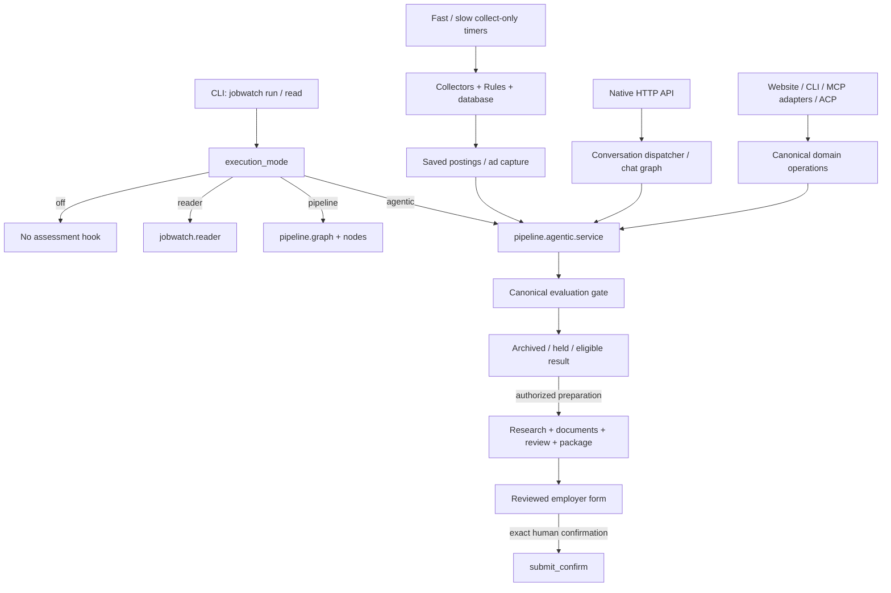
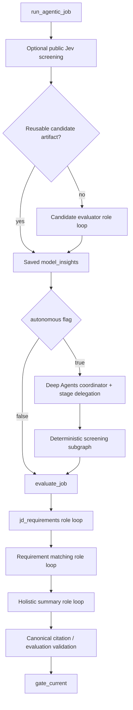
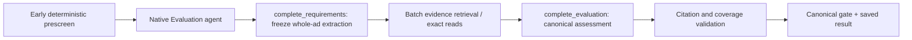

# Jobwatch architecture and assessment cost map

Source inspection: 2026-10-27. Tracking: TASK-279 and GitHub #31.

This is a codebase map, not a release or provider-acceptance claim. The deployed
native checkout is `9111a0d`. The pending replacement is `7a37865` plus uncommitted
assessment, service, skill and test corrections. Source links below resolve into
the pending checkout; passages explicitly labelled **deployed** describe the
separately inspected `9111a0d` source. Line numbers differ between those snapshots.

The subsequent [existing-run investigation and clarified candidate digest](assessment-failures.md)
adds the owner-required model-aware candidate understanding before deterministic
filtering. It supersedes any implication below that removing paid candidate
analysis entirely is the final approved design.

## Reading guide

Start with the execution map, then the assessment cost trace. The domain table
connects career operations to their canonical services. The [source catalog](source-catalog.md)
indexes 630 code, configuration, asset and test files: 226 Jobwatch, 100 pipeline,
25 MCP App, 267 tests and 12 configuration/deployment/scripts/tools entries.
It lists Python symbols and local imports, not an inferred runtime call graph.
Documentation and vendored dependency trees are outside that generated catalog.

Product intent remains authoritative in [INTENT](../../INTENT.md), the native
contract in [CHAT](../../pipeline/agentic/CHAT.md), and terminology in
[GLOSSARY](../../GLOSSARY.md). Existing [ADRs](../adr/) explain decisions.

## 1. Product and framework ownership

Jobwatch implements Career Ops-style career workflows as a profile-driven native
backend, augmented by statistical/mathematical models and Jev integrations.

| Layer | Owns | Does not establish |
|---|---|---|
| Career Ops methods | Career workflow domains, full-ad evaluation, evidence-based documents, tracking and preparation | A functioning autonomous Jobwatch backend |
| LangChain | Chat-model/tool interfaces and embeddings interfaces | Valid candidate facts or an approved provider route |
| Deep Agents | Agent graph assembly, scoped specialist tools, skills, optional memory/planning | Efficient call counts merely by wrapping old role loops |
| LangGraph | Graph progression, checkpoint interfaces and interrupts | Exactly-once paid dispatch or exact-form consent by itself |
| Canonical Jobwatch services | Identity, approved profile/evidence, eligibility, artifacts, accounting, packages and confirmed Submit | A successful model assessment merely because a run exists |

Deep Agents is pinned to `0.7.23` in [pyproject](../../pyproject.toml).
Public upstream research is linked at the end; upstream main and DeepWiki are
not claims about the installed package's exact behavior.

## 2. Entry points and execution modes

[pyproject](../../pyproject.toml) registers `jobwatch`, `jobwatch-agent`,
`jobwatch-mcp`, `jobwatch-mcp-app`, `jobwatch-tui` and `jobwatch-acp`.
[cli.main](../../jobwatch/cli.py), [pipeline.run](../../jobwatch/pipeline.py),
[effective_mode](../../jobwatch/execution_mode.py) and
[service.after_collect](../../pipeline/agentic/service.py) are distinct dispatch
boundaries. `--collect-only` skips the AI hook. The `read` CLI calls the agentic
reader service; that service still checks its effective enabled state.

The native API is [api.create_api](../../pipeline/agentic/api.py).
[api_store](../../pipeline/agentic/api_store.py) owns durable API runs/interactions;
[chat](../../pipeline/agentic/chat.py) owns conversation tools and specialists.
Chat is a client-facing orchestration path, not the automatic assessment engine.
Its `career-reader`, `company_researcher` and `market_evaluator` specialists do not
prove those domains run autonomously for every queued posting.

**Observed deployment boundary:** API/web systemd units use the native checkout,
not the older `apps/jobwatch` checkout. Assessment is paused with execution mode
`"off"` and the reader timer inactive. Fast/slow collect-only timers remain active.
No runtime changes or paid experiments were made for this map.

## 3. Collection and the first filter

| Step | Source | Behavior / cost boundary |
|---|---|---|
| Profile gate | [discovery_gate](../../jobwatch/discovery_gate.py) | Discovery requires confirmed profile/scope |
| Source collection | [collectors](../../jobwatch/collectors/) and [pipeline.run_collector](../../jobwatch/pipeline.py) | Fetch and normalize postings; deterministic code, though external websites still cost time |
| Initial filter | [filters.Rules.evaluate](../../jobwatch/filters.py) | Confirmed exclusions, location and database prescreen; not an inherited title allowlist |
| Full ad ingestion | [nodes.ingest](../../pipeline/nodes/ingest.py), [adtext](../../jobwatch/adtext.py) | Capture ad and liveness; distinguish unavailable/partial/full text |
| Saved-posting prescreen | [prescreen.engine](../../jobwatch/prescreen/engine.py), [lifecycle](../../jobwatch/prescreen/lifecycle.py) | Reversible admit / flag / skip with rules, terms and overrides |
| Reader queue | [discovery.enforce_exclusions](../../pipeline/agentic/discovery.py), [service.after_collect](../../pipeline/agentic/service.py) | Recheck exclusions/prescreen; dedupe, relevance and ordering vary by settings |

The archived title/keyword/seniority filter was not copied verbatim. Current
preferences belong to each confirmed profile; keywords aid discovery rather
than proving personal fit. Unknown or ambiguous cases may remain flagged.

The recorded token incident followed an **admit**, so existence of a first filter
does not explain away the evaluator cost. Separately, deployed direct assessment
does not perform the new early prescreen before public Jev and candidate work.
The pending service repairs that ordering and binds prescreen terms/rules/overrides
to run identity, including cached READY freshness checks. Stored classification
is absent where the posting schema never retained it; do not invent that input.

## 4. Deployed assessment: the paid execution trace

In deployed [service.run_agentic_job](../../pipeline/agentic/service.py), an
uncached candidate calls [assessment.evaluate_candidate](../../jobwatch/candidate/assessment.py).
The deployed wrapper's `evaluation` node in `autonomous.evaluate_autonomous`
then calls `evaluate_job(..., role_runner=run.role)`. It changes transport and
persistence around the existing stages; it does not eliminate them.

[evaluator.evaluate_job](../../pipeline/agentic/evaluator.py) runs three paid roles:
`jd_requirements`, focused requirement matching, then holistic summary. Candidate
assessment makes a fourth cold role session. **Four roles does not mean four calls.**
Each role selects reads/searches and a terminal operation through repeated model
turns. Public research and embeddings can add provider operations.

### Where context and calls multiply

| Mechanism | Source evidence | Consequence and limit of finding |
|---|---|---|
| Role restart | [deepagents_runtime._invoke](../../pipeline/agentic/deepagents_runtime.py) creates a graph for each role, with full allowed schemas and a fresh context | Repeated system/schema material between roles; does not imply every byte is identical |
| Repeated ad | `jd_context`, `matching_context` and final `context` in [evaluator](../../pipeline/agentic/evaluator.py) contain ad text | Same ad enters requirements, matching and summary sessions |
| Tool transcript growth | `GatewayChatModel._generate_once` serializes current messages through [gateway.messages_for_gateway](../../pipeline/agentic/gateway.py) | Prior tool reads/results remain in subsequent requests within that role |
| Repeated candidate reasoning | [candidate.assessment](../../jobwatch/candidate/assessment.py) then evaluator evidence matching/summary | Cold candidate reasoning can precede another job-specific evidence pass; cache reuse must be distinguished |
| Extra supervisor | Deployed `autonomous.evaluate_autonomous` uses a model to delegate already prescribed stages | Adds calls without replacing old evaluator work |
| Correction/retry | [deepagents_runtime.GatewayChatModel._generate](../../pipeline/agentic/deepagents_runtime.py) allows one configured validation correction and a transient retry | Each actual dispatch costs usage; a failed final job can still be expensive |
| Output allowance | Role default `max_output_tokens=12000`, raised by model-profile minimum | Allowance is not actual completion usage; reasoning can consume it |
| Unlimited settings | [runtime.JobBudget](../../pipeline/agentic/runtime.py) honors nullable limits | Owner authority remains; Unlimited is not an efficiency fix |

The legacy role adapter explicitly instructs one `{tool, arguments}` JSON response
per turn. Deep Agents running underneath it does not make that protocol a native
multi-tool stage agent. A model-name change alone does not replace the protocol.

### Incident evidence and attribution

The containment investigation recorded posting 2143 at 25 evaluator reservations/
calls and 225,422 actual/charged tokens, ending held `invalid_evaluation`, after
full-ad prescreen admit. Those are prior recorded incident measurements, not a new
run performed for this document. They do not provide a per-prompt causal breakdown.
The source trace establishes repeated sessions/context and added wrapper work;
it cannot assign an exact percentage of the incident to each mechanism.

## 5. Pending native replacement: implemented, not accepted live

The pending [autonomous](../../pipeline/agentic/autonomous.py) replaces the above
inner sequence with deterministic screening and one native Evaluation graph.

`NativeModel._generate` requests `json_mode=False` and `native_response=True`;
native tool messages are retained. `complete_requirements` keeps the initial
extraction candidate-blind, then exposes bounded candidate/model context.
RequirementEvidenceSearch remains canonical. Completion checks exact source/hash/
quote, accessed evidence, coverage and judgments before accepting an evaluation.
There is no `evaluate_job` invocation inside that replacement agent and no paid
supervisor. The legacy service branch still exists for non-native configuration.

The pending service removes paid `evaluate_candidate` only from the native path,
retaining deterministic structural analysis. It persists public screening, journals
native replies before tool execution, restores counts, and caches person/evidence/
model-bound embeddings. Input changes invalidate reuse. Configured limits are
honored; the 3–6 call target is not imposed as a hidden six-call spending cap.

Real DeepSeek native responses have been observed, but controlled attempts did
not complete a valid canonical evaluation. Schema/citation reliability and total
cost remain unresolved. Synthetic three-call tests establish mechanics only.
This source is **not deployed or accepted as working**. No further paid tests
were run to create this map.

## 6. Career domain services, models and Jev

| Domain | Canonical source | Agent / computation boundary |
|---|---|---|
| Identity | [users](../../jobwatch/users.py), [identity](../../pipeline/agentic/identity.py), [api](../../pipeline/agentic/api.py) | Authentication binds person; tools do not accept arbitrary caller identity |
| Profile intake | [candidate.intake](../../jobwatch/candidate/intake.py), [profile_api](../../pipeline/agentic/profile_api.py), [attachments](../../pipeline/agentic/attachments.py) | Uploaded evidence → proposal → human confirmation → approved version/scope |
| Evidence | [candidate.evidence](../../jobwatch/candidate/evidence.py), [matching](../../pipeline/agentic/matching.py) | Snapshot and exact citations; retrieval ranking is not proof |
| Eligibility | [gate](../../pipeline/agentic/gate.py), [candidate.eligibility](../../jobwatch/candidate/eligibility.py), [candidate.policy](../../jobwatch/candidate/policy.py) | Deterministic authoritative decision, separate from holistic score |
| Structural fit | [candidate.analysis](../../jobwatch/candidate/analysis.py), [occupations](../../jobwatch/occupations/) | 60% activity coverage + 40% cosine; proximity, not qualification/hiring probability |
| Preferences | [preferences.model](../../jobwatch/preferences/model.py), [choice_model.jags](../../jobwatch/preferences/choice_model.jags), [preference_service](../../jobwatch/preference_service.py) | Local R/JAGS conditional-logit; validated readiness and current eligible alternatives |
| Outcomes | [outcomes.callback](../../jobwatch/outcomes/callback.py), [outcomes](../../jobwatch/outcomes/) | Beta-Binomial, Beta(1,15) prior, uncertainty; unresolved submissions censored |
| Shared model integration | [model_insights.pipeline_insights](../../pipeline/agentic/model_insights.py) | Saves structural summary, preference readiness and callbacks for evaluation/writing; no automatic refit |
| Employer research | [company_research](../../pipeline/agentic/company_research.py), [research](../../pipeline/agentic/research.py) | Public cited employer context, never candidate proof |
| Documents | [draft](../../pipeline/agentic/draft.py), [review](../../pipeline/agentic/review.py), [letter_rules](../../pipeline/agentic/letter_rules.py), [apply.verify](../../jobwatch/apply/verify.py) | Tailoring, factual review, rendering/verification and immutable package persistence |
| Shortlist / selection | [shortlist](../../pipeline/agentic/shortlist.py), [ranking](../../pipeline/agentic/ranking.py), [selection](../../pipeline/agentic/selection.py) | Explained canonical entries and exact selected preparation, not all stored postings |
| Application | [apply.prepare](../../jobwatch/apply/prepare.py), [browser_api](../../pipeline/agentic/browser_api.py), [apply.submit_confirm](../../jobwatch/apply/submit_confirm.py) | Prepared form, exact reviewed-state approval and press-time recheck |
| Follow-up / interview | [followup](../../pipeline/agentic/followup.py), [interview](../../pipeline/agentic/interview.py), [followup_drafts](../../jobwatch/followup_drafts.py), [interview_prep](../../jobwatch/interview_prep.py) | Preparation/drafting operations; not autonomous contact authority |

The outcome subsystem also includes [response-time readiness](../../jobwatch/outcomes/readiness.py):
this is an inventory of responses and censored cases with `model=none`, not an
active survival model. [Outcome sync](../../jobwatch/outcomes/sync.py) turns observed
mail into proposals, while [owner decisions](../../jobwatch/outcomes/decide.py)
apply approved status changes. [commands.state](../../jobwatch/commands/state.py)
and the [ledger](../../jobwatch/ledger.py) retain application history.

Selected preparation in [selection.request / execute](../../pipeline/agentic/selection.py)
binds current entries/run keys and invokes operation `prepare`; it does not imply
Submit. [BrowserService](../../jobwatch/apply/browser.py) can fill READY packages,
then stops for exact review/confirmation. Native API approval scopes and MCP host
explicit-consent contracts are different adapter boundaries; model text alone
cannot supply either human authority.

Offer negotiation, upskill/development and broader outcome learning are intended
Career Ops domains; existing modes, helper functions or model tools must not be
reported as a complete autonomous stage without a traced operation and observed
result. This map does not assert those stages are delivered.

### Jev integration inventory

| Integration | Source / call site | Actual status |
|---|---|---|
| Public ad injection / knockout signals | [openrouter_extras.jev_screen](../../jobwatch/openrouter_extras.py) → service | Injection screening is wired; applicable_knockouts returns an empty set, so public citizenship/seniority probabilities cannot personally exclude |
| Same-vacancy classifier | `same_vacancy` → service `_near_duplicates` | Wired helper; execution depends on discovery path/settings |
| Target-role ranking | `rank_by_target` → service `_target_first` | Wired helper; not qualification proof |
| Candidate fit second opinion | [jev_skills.fit_scores](../../pipeline/agentic/jev_skills.py) | Core service supplies `facts=[]`; branch does not execute |
| Candidate requirement mapping | `jev_skills.requirement_map` | Same inactive candidate-facts boundary |
| Unsupported document claims | `jev_skills.unsupported_claims` → draft `jev_checked` | Returns without checking when no facts supplied by core service |
| Form label matching | [apply.jev_forms.jev_prefill](../../jobwatch/apply/jev_forms.py) → prepare | Wired; labels sent, answer values filled by local code |
| Safe next-page classification | `jev_next_button` → prepare | Wired; final-submit-like controls excluded; no approval authority |

Public Jev is a direct classifier route, distinct from OmniRoute chat and canonical
Qwen embeddings. The presence of candidate-related Jev source is not approval to
send private evidence to that route. Both deployed and pending core service keep
those branches inactive. Chat also disables legacy openrouter_extras in its copied config; form helpers are called separately without that propagated extras config. Jev availability therefore varies by path, not one global enabled/disabled claim. Browser/provider success was not exercised here.

## 7. State, recovery, accounting and trust

| Store / boundary | Owner | Required meaning |
|---|---|---|
| Per-person jobwatch.db | [db](../../jobwatch/db.py), users helpers | Postings, collection runs, ad captures, prescreen decisions, history; root and person databases differ |
| Agentic run ledger | [store.AgenticStore](../../pipeline/agentic/store.py) | Claims/leases, run status, budget operations, artifacts, packages, outbox |
| Artifacts and ledger files | [persistence.PersistenceAdapter](../../pipeline/agentic/persistence.py) | Hash-checked canonical output and package recovery; not evidence that a model succeeded |
| API runs / interactions | [api_store](../../pipeline/agentic/api_store.py) | Durable requests, pending typed interactions, cancellation and identity |
| Chat checkpoints / memory | [chat_storage.ChatSaver / ChatStore](../../pipeline/agentic/chat_storage.py) | Local per-person graph state; advisory memory cannot become a profile fact |
| Autonomous checkpoints | [autonomous.Slice](../../pipeline/agentic/autonomous.py) and private SQLite helper | Input/person-bound stage state; pending version journals completed native replies |
| Job / batch budget | [runtime.JobBudget / BatchBudget](../../pipeline/agentic/runtime.py) | Reserve, mark dispatch, settle actual usage or retain conservative unknown charge |
| Invocation accounting | [execution.Execution](../../pipeline/agentic/execution.py), [gateway](../../pipeline/agentic/gateway.py) | Include child/orchestration/provider operations; do not conflate unknown reservations with measured usage |
| Incidents | [incidents](../../pipeline/agentic/incidents.py) | Failure/phase history and paused recovery; never silently erase or release |

Model names and transport profiles are separate in [model_choice](../../jobwatch/model_choice.py).
`native_tools`, `json_mode` and output floors affect protocol independently from
the selected evaluator. [llm](../../jobwatch/llm.py) implements the paid transport;
execution route checks and disabled hosted tracing remain mandatory.

No model can grant consent. General preparation approval does not authorize
submission. `submit_confirm` binds exact reviewed employer/form/package/browser
inputs; changed inputs invalidate approval, and an uncertain press is not retried.

## 8. Clients, tooling and verification scope

| Area | Source | Role |
|---|---|---|
| Native web board | [jobwatch.web](../../jobwatch/web/) | Separate authenticated frontend and domain routes |
| HTTP agent API | [api](../../pipeline/agentic/api.py), [client_api](../../pipeline/agentic/client_api.py), [librechat](../../pipeline/agentic/librechat.py) | Native operations and chat compatibility; identity stays server-bound |
| Python MCP / connector | [mcp_server](../../pipeline/agentic/mcp_server.py), [connector_http](../../pipeline/agentic/connector_http.py) | Adapters over native/canonical operations |
| TypeScript MCP App | [mcp-app](../../mcp-app/) | Tools, embedded views and guidance; no separate eligibility policy |
| Terminal / ACP | [tui](../../pipeline/agentic/tui.py), [acp_agent](../../pipeline/agentic/acp_agent.py) | Alternate clients, not a second career engine |
| Legacy engines | [reader](../../jobwatch/reader.py), [pipeline.graph](../../pipeline/graph.py), [nodes](../../pipeline/nodes/) | Retained modes; do not confuse them with corrected native assessment |
| Tests and evaluation | [tests](../../tests/), [baseline](../../pipeline/agentic/baseline.py), [evaluate_runs](../../pipeline/agentic/evaluate_runs.py), [eval_metrics](../../pipeline/agentic/eval_metrics.py) | Mechanics, frozen comparisons and diagnostics; not production acceptance by existence |

This document was verified against source and existing runtime unit paths, without
model calls, candidate-record reads or deployment. No application tests were run
for documentation. Known incomplete release checks and provider failures remain
on TASK-279; this map does not supersede them. The generated catalog should be
regenerated when source changes, and the architecture narrative reviewed whenever
execution boundaries change.

## 9. Design comparison and repair order

The mismatch is architectural: the deployed assessment uses multiple serial role
loops plus an optional supervisor, while the intended first slice is deterministic
screening plus one evidence-backed native agent producing canonical evaluation.
Statistical models should remain shared calculation services; Jev should remain a
scoped classifier integration. Neither needs another paid supervisor.

| Priority | Work | Evidence required |
|---|---|---|
| 1 | Keep faulty assessment paused and collection available | Effective mode/timers and preserved accounting |
| 2 | Resolve native canonical-completion failure | One controlled valid provider outcome, exact citations and gate result |
| 3 | Measure whole-job efficiency | Calls by purpose; prompt/completion/reasoning/cache tokens; embeddings/classifier usage; wall time; cold/reused context |
| 4 | Verify recovery / identity / freshness, then release | No repeated completed paid work; changed inputs invalidate; required checks and live path evidence |
| 5 | Expand domain agents after the first slice | Canonical tools, durable outputs and observed domain results rather than decorative prompts |

This is a comparison and repair sequence, not a new spending limit or authorization
to resume paid experiments during the mapping request.

## Upstream references

[Career Ops mode router](https://github.com/career-ops-hq/career-ops/blob/main/.agents/skills/career-ops/SKILL.md),
[Career Ops oferta](https://github.com/career-ops-hq/career-ops/blob/main/modes/oferta.md),
[Deep Agents graph assembly](https://github.com/langchain-ai/deepagents/blob/main/libs/deepagents/deepagents/graph.py).
Read through DeepWiki and checked against upstream source on 2026-10-27.

DeepWiki returned [Career Ops workflow research](https://deepwiki.com/search/map-the-complete-career-workfl_fa174816-3499-4826-860d-ac9b215f5c68),
[Career Ops glossary](https://deepwiki.com/career-ops-hq/career-ops#12),
[Deep Agents architecture research](https://deepwiki.com/search/for-implementing-career-ops-as_66319bc6-c031-4434-8e58-5764ab4c5107),
and [Deep Agents architecture overview](https://deepwiki.com/langchain-ai/deepagents#1.3).
DeepWiki is an unversioned snapshot; checkpoint storage optimization is not proof
of reduced inference tokens or exactly-once paid execution.
